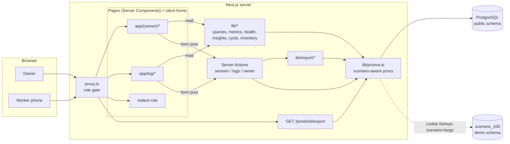
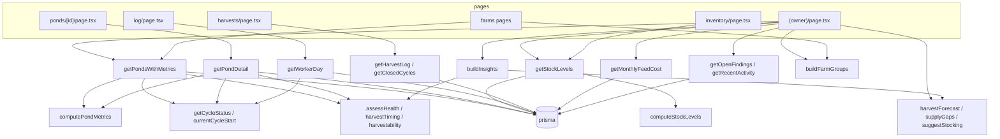
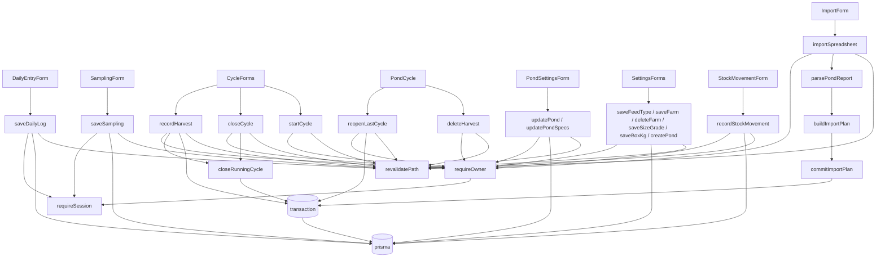

# Fisheye: architecture and concepts

A fish-pond performance tracker for aquaculture farms. Workers log feed and dead fish from an Android phone; the owner sees stock, cost, growth, harvest timing and alerts on a dashboard.

> **Update 2026-10-05:** the app is now split into `frontend/` (Next.js, client-side), `backend/` (Hono REST API) and `shared/` (pure TypeScript). Read [`2026-10-05-rest-api-refactor.md`](./2026-10-05-rest-api-refactor.md) for what changed and [`API.md`](./API.md) for the endpoints. This file still describes the domain rules, data model and screens correctly. Where it mentions **Server Actions**, `lib/...` paths, `proxy.ts` as the only gate, or "server-rendered pages", read: Server Action = a REST endpoint in `backend/src/routes/write.ts` calling `backend/src/lib/actions/`; `lib/queries.ts` = `backend/src/lib/queries.ts`; pure logic = `shared/src/`. The diagrams in `docs/diagrams/` were not regenerated.

Companion files:

- [`database.md`](./database.md): the ER diagram.
- [`diagrams/`](./diagrams): interactive Archify diagrams (open the `.html` files in a browser). Sources are in `diagrams/src/*.json`.

| Diagram | File |
|---|---|
| System architecture | [`diagrams/architecture.html`](./diagrams/architecture.html) |
| Worker saves a daily log (sequence) | [`diagrams/seq-worker-log.html`](./diagrams/seq-worker-log.html) |
| Owner records a final harvest (sequence) | [`diagrams/seq-harvest.html`](./diagrams/seq-harvest.html) |
| CSV import pipeline (data flow) | [`diagrams/dataflow-import.html`](./diagrams/dataflow-import.html) |
| Records to dashboard numbers (data flow) | [`diagrams/dataflow-metrics.html`](./diagrams/dataflow-metrics.html) |
| Pond cycle states (lifecycle) | [`diagrams/lifecycle-cycle.html`](./diagrams/lifecycle-cycle.html) |

The Mermaid diagrams below render on GitHub and in most Markdown viewers.

---

## 1. Stack

| Layer | Choice |
|---|---|
| Framework | Next.js 16.3 (App Router, React 19.2). `AGENTS.md` warns this version differs from older Next.js; read `node_modules/next/dist/docs/` before changing framework-level code |
| Language | TypeScript |
| Styling | Tailwind CSS 4, IBM Plex fonts, `motion` for animation |
| Database | PostgreSQL through Prisma 7 with the `@prisma/adapter-pg` driver adapter and a shared `pg` Pool (max 5) |
| Charts | Hand-written SVG components in `app/components/charts/` (no chart library) |
| i18n | Own small system: English, Chinese (`zh`), Malay (`ms`) |
| Hosting | Built for Vercel: `npm run build` runs `prisma generate && prisma migrate deploy && next build` |

There is no REST or GraphQL API. The app is **server-rendered pages + Server Actions** (form posts), plus a single Route Handler for CSV export.

## 2. Directory map

```
proxy.ts                       Edge gate: role cookie -> redirect rules
app/
  layout.tsx                   Root: fonts, <html lang>, I18nProvider
  select-role/page.tsx         Sign-in screen (public)
  (owner)/                     Owner section (route group, no URL segment)
    layout.tsx                 Loads ponds + session for the sidebar (OwnerNav)
    page.tsx                   /            Overview dashboard
    farms/page.tsx, farms/[id]/page.tsx    Farm map
    harvests/page.tsx          Harvest log + closed cycles
    inventory/page.tsx         Feed stock
    import/page.tsx            Spreadsheet import
    settings/page.tsx          Feed prices, ponds, farms, size grades, box weight
    ponds/[id]/page.tsx        Pond page with 5 tabs (?view=)
    ponds/[id]/export/route.ts GET CSV download
    reports/ReportPicker.tsx   Month picker component (not currently used by any page)
  log/                         Worker section (phone-first)
    page.tsx                   /log         Daily checklist
    [pondId]/page.tsx          /log/12      One-pond entry form + sampling
  actions/
    session.ts                 signIn, signOut, setLocale, setScenario
    logs.ts                    saveDailyLog, saveSampling, deleteDailyLog (owner + worker)
    owner.ts                   All owner-only mutations
  components/                  ui.tsx, charts/, cycle.tsx, harvest.tsx, icons, motion, i18n provider
  generated/prisma/            Prisma client output (generated, not committed)
lib/                           Pure domain logic + queries (the "brain")
prisma/                        schema, migrations, seed, mock-data scripts
data/                          Pond 1 sample CSV used by the seed
```

## 3. Concepts

| Term | Meaning |
|---|---|
| **Farm** | A site that ponds are grouped under on the farm map. Optional for a pond |
| **Pond** | One culture pond. Holds the *running* cycle directly: `stockedAt`, `stockedCount`, `cycleMonths`, `assumedFcr`, `targetWeightKg` |
| **Culture cycle** | Stocking to harvest (default 8 months). The running one lives on the pond; closing it copies totals into `PondCycle` and clears `stockedAt` |
| **Day key** | `YYYY-MM-DD` string in `Asia/Kuala_Lumpur`. Stored in the DB as UTC midnight of that key so a record never drifts across days (`lib/dates.ts`) |
| **Daily log** | One row per pond per day: feed type, bags, dead fish, note. Unique on `(pondId, date)`; saving again overwrites |
| **Snapshot** | `feedKg` and `feedCostRm` are computed once at save time from the pack size and price then, so later price changes do not rewrite history |
| **Sampling** | Weigh a sample of fish: `avgWeightKg = totalWeight / fishCount`. Drives growth and biomass |
| **ABW** | Average body weight. Stored in kg, displayed in g under 1 kg |
| **FCR** | Feed conversion ratio, kg feed per kg fish. *Assumed* FCR is the pond's planning value; *realized* FCR is measured |
| **Stage** | Growth stage by quarter of the planned cycle: nursery, juvenile, growout, finishing, then ready |
| **Harvest** | A harvest event with optional size-grade lines. A cycle can have several; the one flagged `isFinal` closes the cycle |
| **Size grade** | A weight class used at harvest (e.g. "0.8-1.2 kg") |
| **Box** | Transport unit. `boxKg` setting (default 500 kg) converts weight to boxes (rounded up) |
| **Stock movement** | `count` (physical stocktake that resets the balance) or `delivery` (adds bags) |
| **Import batch** | One CSV upload with its totals and reconciliation findings; deleting it removes the rows it created |
| **Scenario** | `real` farm or the `large` demo (100 ponds, 7 farms) living in its own Postgres schema `scenario_100` |

## 4. System architecture



### 4.1 Request lifecycle

1. Every request except `/_next/static`, `/_next/image` and `favicon.ico` goes through `proxy.ts`.
2. No valid `fisheye_role` cookie: redirect to `/select-role?next=<path>`. `/select-role` and any path with a file extension are public.
3. Role `worker` outside `/log` and `/log/*`: redirect to `/log`.
4. The page (a Server Component) runs. Pages are `force-dynamic`, so figures are recomputed on every request. Nothing is cached.
5. A form submits a Server Action. The action re-checks the role itself (`requireSession` / `requireOwner`), because actions can be POSTed directly, validates, writes, calls `revalidatePath("/", "layout")`, then either returns a `FormState` or redirects.

### 4.2 Role and session (`lib/role.ts`, `lib/session.ts`, `app/actions/session.ts`)

- Cookies (httpOnly, `sameSite=lax`, 1 year): `fisheye_role` (`owner` | `worker`), `fisheye_name` (optional display name, max 40 chars, stored as `recordedBy`).
- `getSession()` returns `{ role, name } | null`. `requireSession()` throws `Not signed in`. `requireOwner()` throws `Only farm owners can do this`.
- `signIn` only allows same-site relative `next` paths; workers always land under `/log`.
- **Important:** there is no password or identity check. The role is a cookie the user chooses on `/select-role`. It separates two screens; it is not security. Anyone who reaches the site can become `owner`. Treat it as a convenience gate until real auth exists.

### 4.3 Scenario switching (`lib/prisma.ts`, `lib/scenario.ts`)

`prisma` is a JavaScript `Proxy`. Each model call first resolves the current request's client:

- Cookie `fisheye-scenario=large` **and** the `scenario_100.ponds` table exists: use a `PrismaClient` whose adapter targets schema `scenario_100`.
- Otherwise the default schema.
- Both clients share one `pg.Pool`. Existence of the demo schema is checked once per process.
- Consequence: use `prisma.$transaction(async (tx) => ...)`, not the array form. Calls return plain promises, not `PrismaPromise`.
- `setScenario` redirects away from pages whose ids differ between scenarios (`/ponds/*`, `/farms/*`).

### 4.4 Internationalisation (`lib/i18n/*`)

- Cookie `fisheye_lang` (`en` | `zh` | `ms`), default `en`. `setLocale` sets it and revalidates the layout.
- Server: `getI18n()` (React `cache`d per request) returns `{ locale, t, fmt }`. Client: `I18nProvider` supplies the same messages.
- Message keys are typed (`MessageKey` from `messages/en.ts`). Health checks and insights carry a key plus params, so they translate on display.
- Number, date and currency formatters live in `lib/format.ts` and `lib/dates.ts`.

## 5. Database

Full ER diagram: [`database.md`](./database.md). Prisma schema: `prisma/schema.prisma`. Migrations: `prisma/migrations/` (init Postgres, then harvests, farms and specs).

| Table | Purpose | Notable rules |
|---|---|---|
| `farms` | Site grouping | `name` unique. Deleting sets `ponds.farm_id` to NULL |
| `ponds` | Pond + running cycle + specs + water status | `name` unique. Water: `waterStatus` good/fair/poor, `waterNote`, `waterCheckedAt` |
| `pond_cycles` | Closed cycles with totals snapshot | Unique `(pond_id, number)`. `outcome` = `harvested` or `lost`. Cascades with pond |
| `feed_types` | Feed catalogue | `code` unique, `pack_size_kg`, `price_per_kg`, `active` |
| `daily_logs` | One row per pond per day | Unique `(pond_id, date)`. `source` = `app` or `import`. Cascades from pond and import batch |
| `samplings` | ABW samples | Index `(pond_id, date)`. Same source/batch columns |
| `stock_movements` | Feed store ledger | `kind` = `count` or `delivery` |
| `import_batches` | One CSV upload | `summary` and `findings` are JSON strings |
| `harvests` | Harvest events | `cycle_id` NULL while the cycle is running; set when it closes. `is_final` closes the cycle |
| `harvest_lines` | kg per size grade per harvest | Grade deletion is RESTRICTed while lines exist |
| `size_grades` | Size classes | `label` unique, `sort_order` |
| `settings` | Key/value | Only key in use: `boxKg` |

Cascades: deleting a pond removes its logs, samplings, imports, cycles and harvests. Deleting an import batch removes the logs and samplings it created.

### 5.1 Derived values (never stored)

All computed in `lib/metrics.ts` from the running cycle's rows:

| Value | Formula |
|---|---|
| Estimated biomass | `sum(feedKg) / assumedFcr` |
| Estimated harvestable kg | `max(biomass - deadKg - harvestedKg, 0)`. `deadKg` = dead count x average weight that applies to that day |
| Average weight that applies to a day | Sample in the same month, else latest earlier sample, else first sample |
| Fish alive | `stockedCount - dead - harvested fish` (needs `stockedCount`) |
| Survival rate | `(stockedCount - dead) / stockedCount` |
| Sampling biomass | `fishAlive x latest ABW` |
| Realized FCR | `sum(feedKg) / (samplingBiomass + harvestedKg)` |
| Daily gain | `(latest ABW - previous ABW) / days between samples` |
| Feed cost per kg | `feedCost / (estimatedHarvestKg + harvestedKg)` |
| Recent daily feed | last 7 days of records / 7 |
| Feeding rate % | `recent daily feed / (sampling biomass or estimated harvest) x 100` |
| Month rows | per calendar month: days logged, bags, kg, RM, dead, cumulative feed, estimated biomass, kg per feed type |

Cycle scoping: `currentCycleStart` is `pond.stockedAt`, or the day after the last closed cycle if the pond is empty, else every record. Earlier cycles do not pollute the running totals.

## 6. Function relationships

### 6.1 Read path



### 6.2 Write path



### 6.3 Module reference (`lib/`)

| Module | Exports | Role |
|---|---|---|
| `dates.ts` | `todayKey`, `dayKeyToDate`, `dateToDayKey`, `isDayKey`, `addDays`, `addMonths`, `daysBetween`, `formatDay`, ... | Timezone-safe calendar arithmetic |
| `format.ts` | `formatKg`, `formatRm`, `formatAbw`, `formatBags`, `formatPercent` | Display formatting |
| `cycle.ts` | `STAGES`, `getCycleStatus`, `stageSpans`, `currentCycleStart`, `harvestForecast`, `supplyGaps`, `suggestStocking`, `fcrRating` | Cycle state machine and planning |
| `metrics.ts` | `computePondMetrics`, `avgWeightResolver` | All production figures |
| `health.ts` | `assessHealth`, `harvestTiming`, `harvestability`, `findMortalitySpike` | Rule-based health, harvest timing |
| `insights.ts` | `buildInsights` | Owner alert list from ponds + stock |
| `inventory.ts` | `computeStockLevels` | On-hand bags and days of cover |
| `harvest.ts` | `cultureDay`, `estimateBoxes`, `gradeMix`, `topGrade`, `harvestTotals`, `averageFishKg` | Harvest maths |
| `monthReport.ts` | `availableMonths`, `buildMonthReport` | Monthly report builder (only used with the unmounted `ReportPicker`) |
| `farmMap.ts` | `MANY_PONDS` (12), `buildFarmGroups` | Group ponds under farms |
| `queries.ts` | `getPondList`, `getFeedTypes`, `getPondsWithMetrics`, `getPondDetail`, `getStockLevels`, `getWorkerDay`, `getHarvestLog`, `getSizeGrades`, `getFarms`, `getMonthlyFeedCost`, `getClosedCycles`, `getRecentActivity`, `getOpenFindings` | Prisma reads that assemble the above |
| `settings.ts` | `getBoxKg` | Reads the `boxKg` setting |
| `import/*` | `parseCsv`, `parsePondReport`, `buildImportPlan`, `commitImportPlan` | CSV import |
| `prisma.ts`, `scenario.ts`, `session.ts`, `role.ts`, `i18n/*` | see sections 4.2 to 4.4 | Infrastructure |

## 7. Routes and endpoints

### 7.1 Pages (GET)

| URL | Who | Query params | What it returns (rendered) |
|---|---|---|---|
| `/select-role` | everyone | `next` | Two forms (owner / worker) with optional name, language switcher |
| `/` | owner | `stage` (stage filter or `empty`), `all=1` | Overview: stat cards (standing stock, feed cost today/month), ready-to-harvest banner (max 6), cycle board by stage, monthly feed chart (stacked by pond, by farm above 8 ponds), pond table (15 rows, "Show all"), alerts from `buildInsights`, open import findings, stock summary, recent app entries, harvest forecast |
| `/farms` | owner | | Status counts, ponds grouped by farm with health/harvest badges, estimated kg and boxes, harvest queue |
| `/farms/[id]` | owner | | One farm's map and cycles. 404 on bad id |
| `/harvests` | owner | `pond` (filter to one pond) | Totals, monthly harvest chart, size-grade mix, harvest log (newest first, with culture day), closed cycles |
| `/inventory` | owner | | Per-feed-type on hand, last count, deliveries, daily use, days of cover; movement log with delete |
| `/import` | owner | `pond` | Upload form, pond picker, feed catalogue |
| `/settings` | owner | | Feed catalogue/prices, ponds (create), farms, size grades, box weight |
| `/ponds/[id]` | owner | `view` = `overview` / `cycle` / `records` / `data` / `settings`; `month` (records); `imported` | Header, ready banner, cycle stepper, tab bar, then the chosen tab. 404 on bad id |
| `/log` | worker, owner | `date`, `saved`, `pond` | Checklist of ponds with today's status; date stepper; typing a pond number redirects to its form |
| `/log/[pondId]` | worker, owner | `date`, `returnTo` | Daily entry form pre-filled with that day's row, previous day for reference, sampling form. 404 on bad id |

Pond page tabs: **Overview** (KPIs, growth, health checks, feed programme, monthly table), **Cycle** (harvests, size grades, record harvest, record loss, restock, reopen), **Records** (daily records by month with edit and delete), **Data** (samplings and import batches with rollback), **Settings** (pond fields, physical specs, water status).

### 7.2 Route Handler

| Method and URL | Auth | Returns |
|---|---|---|
| `GET /ponds/[id]/export` | owner (403 otherwise), 404 if no pond | `text/csv` attachment `<Pond-name>-daily-records.csv`, `Cache-Control: no-store`. Columns: `date, culture_month, feed_type, bags, feed_kg, feed_cost_rm, dead_fish, avg_weight_kg, dead_kg, note, recorded_by, source`. One row per recorded day (all cycles) |

### 7.3 Server Actions

All are POSTed from forms. `FormState = { status: "idle"|"error"|"success"; message?: string; fieldErrors?: Record<string,string> }`. Actions used with `useActionState` return it; actions used directly as `<form action>` return nothing (or redirect).

**Session (`actions/session.ts`, no role required)**

| Action | Input | Effect | Returns |
|---|---|---|---|
| `signIn` | `role`, `name?`, `next?` | Sets role (+ name) cookies | Redirect: worker to `/log` (or `next` if under `/log`), owner to safe `next` or `/` |
| `signOut` | none | Deletes role cookie | Redirect `/select-role` |
| `setLocale` | `locale` | Sets language cookie, revalidates | nothing |
| `setScenario` | `scenario`, `from` | Sets scenario cookie | Redirect to a safe page |

**Logging (`actions/logs.ts`, any signed-in role)**

| Action | Input | Validation | Writes | Returns |
|---|---|---|---|---|
| `saveDailyLog` | `pondId, date, feedTypeId, bags, deadCount, note, returnTo` | valid day, not in future, worker only within last 7 days; bags 0-200; dead whole 0-100000; bags need a feed type; pond and feed type exist | upsert `daily_logs` on `(pondId, date)` with snapshot `feedKg = bags x pack`, `feedCostRm = feedKg x price`; `source="app"`, clears `importBatchId`; `recordedBy` = name or Owner/Worker | `FormState` on error; on success redirect to `returnTo` (if under `/ponds/`) else `/log?date=..&saved=<pondId>` |
| `saveSampling` | `pondId, date, fishCount, totalWeightKg` | date rules as above; 1-10000 fish; 0-10000 kg | insert `samplings` with `avgWeightKg = total / count` | `FormState` (`success.sampleSaved`) |
| `deleteDailyLog` | `id` | worker may delete only own `app` rows within 7 days; owner any | delete `daily_logs` | nothing |

**Owner-only (`actions/owner.ts`)**

| Action | Input | Key rules | Writes | Returns |
|---|---|---|---|---|
| `updatePond` | name, species, stockedAt, stockedCount, assumedFcr (0.5-5), cycleMonths (1-36), targetWeightKg (<=50), farmId, active | unique name; stockedAt not future and after last cycle end | update `ponds` | `FormState` |
| `updatePondSpecs` | areaM2, depthM, aerators, pondType, waterSource, waterStatus (good/fair/poor), waterNote, waterCheckedAt | positive numbers | update `ponds` | `FormState` |
| `createPond` | name, species, farmId | unique name | insert `ponds` | redirect `/ponds/<id>` |
| `saveFarm` / `deleteFarm` | name / id | unique name | insert/update/delete `farms` | `FormState` / nothing |
| `saveSizeGrade` | label, minKg, maxKg, sortOrder, active | unique label | insert/update `size_grades` | `FormState` |
| `saveBoxKg` | boxKg | positive | upsert `settings.boxKg` | `FormState` |
| `saveFeedType` | code, packSizeKg (<=100), pricePerKg (<=100), active | unique normalised code | insert/update `feed_types` | `FormState` |
| `recordStockMovement` | feedTypeId, kind (`count`/`delivery`), date, bags, note | not future; delivery needs bags > 0 | insert `stock_movements` | `FormState` |
| `deleteStockMovement`, `deleteSampling`, `deleteImportBatch` | id | | delete row (batch cascades to its logs and samplings) | nothing |
| `importSpreadsheet` | `file` (CSV, <= 900 KB), `target` (pond id or `new`), `newPondName`, `species` | parse errors become messages; needs at least one daily entry | see section 8 | redirect `/ponds/<id>?view=data&imported=<batchId>` or `FormState` error |
| `recordHarvest` | pondId, date, boxes, fishCount, note, isFinal, parallel `gradeId[] lineKg[] lineFish[]` | needs a running cycle; date between stocking and today; grade exists, kg > 0, no duplicate grade; total weight positive | transaction: insert `harvests` + `harvest_lines`; if final, close the cycle (below) | `FormState` (`success.harvest` / `success.finalHarvest`) |
| `deleteHarvest` | id | only harvests of the running cycle | delete | nothing |
| `closeCycle` | pondId, endedAt, fishCount, cause, note | total loss only; cause required | transaction: close running cycle as `lost`, attach partial harvests | `FormState` |
| `startCycle` | pondId, stockedAt, stockedCount | pond must be empty; after last cycle end; not future | set `ponds.stockedAt/stockedCount` | `FormState` |
| `reopenLastCycle` | pondId | pond must be empty | transaction: delete final harvest, detach other harvests, restore `stockedAt/stockedCount`, delete the cycle | nothing |

**Closing a cycle (`closeRunningCycle`)**: sum `feedKg`, `feedCostRm`, `deadCount` of daily logs between stocking and end date; insert `pond_cycles` with `number = last + 1`, outcome, harvest kg and fish count; set `ponds.stockedAt = null`, `stockedCount = null`. Harvests of the running cycle get that `cycleId` afterwards.

## 8. CSV import (`lib/import/*`)

Input: the farm's "Fish Pond Performance Report" spreadsheet (sample in `data/`).

1. `parseCsv` splits the grid. `parsePondReport` finds monthly block headings such as `Dec-25 (0 Month)`, anchors the stocking month, reads each block's DATE / FEED TYPE / QUANTITY / DEAD FISH rows, the monthly cost tables, and the average-weight summary. Problems become `Finding`s (`error` / `warning` / `info`). Fatal problems throw `PondReportError`.
2. `buildImportPlan` prices each day from that month's cost table (falling back to the catalogue), adds unknown feed codes to the catalogue, and reconciles recomputed totals with the sheet's own figures (wrong month labels, copied cost tables, wrong pack size).
3. `commitImportPlan` runs one transaction: upsert new feed types, create or find the pond (set `stockedAt` if empty), delete old `import` rows for the same dates, **skip dates already entered through the app** (they are newer), insert the batch, daily logs and samplings with `source="import"`.
4. The pond's **Data** tab shows the findings. Deleting the batch rolls the import back.

`prisma/seed.ts` uses the same three functions to import Pond 1 and seeds the feed catalogue and Ponds 1 to 7. `prisma/mock.ts` fills Ponds 2 to 7 with made-up history; `prisma/scenario.ts` builds the 100-pond demo schema.

## 9. Rules engines

### 9.1 Cycle state (`getCycleStatus`)

| State | When |
|---|---|
| `unset` | no `stockedAt` and no closed cycle |
| `growing` | `stockedAt` set and planned harvest date (stocked + `cycleMonths`) not yet reached; carries day, progress, stage, days to harvest |
| `ready` | progress >= 100% |
| `empty` | no `stockedAt` but a closed cycle exists (outcome harvested or lost) |

Stage = quarter of planned length: 0-25% nursery, 25-50% juvenile, 50-75% growout, 75-100% finishing, then ready.

### 9.2 Harvestability (`harvestability`)

`ready` if the cycle is ready, or the latest ABW reached `targetWeightKg`, or the harvest-by date has passed. Else `harvesting` if partial harvests exist, `soon` if harvest-by is within 30 days, otherwise `growing`. `empty` and `unset` pass through. Harvest-by is the earlier of the planned date and the projected date the growth rate hits the target (projection discarded beyond 2 years).

### 9.3 Pond health (`assessHealth`) is shown only while growing or ready

| Check | Good / watch / risk |
|---|---|
| Survival | >= 85% / 70-85% / < 70% |
| Mortality spike | risk when the highest of the last 7 days is >= 3 fish and >= 3x the prior 28-day daily average |
| FCR | at or below target / up to 15% above / more than 15% above |
| Growth | watch if daily gain <= 0 |
| Logging | watch if nothing logged or gap > 1 day, risk if gap > 3 days |
| Sampling | watch if never sampled (with logs) or older than 30 days |
| Water | good / fair = watch / poor = risk; watch if last checked more than 14 days ago |

Overall level is the worst check; checks are sorted worst first.

### 9.4 Owner insights (`buildInsights`)

Severity `critical` / `warning` / `info`, each with a title, detail and link. Includes: pond empty for 30+ days, all fish dead (recorded deaths >= stocked), half dead, high FCR, ready past planned date, at target weight, harvest within 14 days, poor water, logging gaps (warning 2-3 days, critical > 3), mortality spike, sampling due, stocked fish count missing, no feed stocktake yet, low feed stock (warning under 7 days of cover, critical under 3), open import findings, and supply gaps (months with no planned harvest).

### 9.5 Feed stock (`computeStockLevels`)

`onHand = lastCount.bags + deliveriesSinceCount - bagsLoggedSinceCount`. With no stocktake the balance is unknown (null), not guessed. Average daily use is measured over 14 days ending at the latest record (so a paused farm does not read as zero). `daysOfCover = onHand / avgDaily`.

## 10. User interactions

### Worker (phone, `/log`)

| Step | What happens | What comes back |
|---|---|---|
| Open site, pick **Farm worker**, enter name | `signIn` sets cookies | Redirect to `/log` |
| See today's checklist | `getWorkerDay(date)`: every active pond with today's row, previous row, cycle state | Checklist (or number grid above 12 ponds) with done count |
| Move date back or forward | `?date=` (not future) | Same list for that day |
| Type a pond number | `?pond=7` | Redirect to `/log/<id>` |
| Open a pond | Server loads pond, active feed types, existing row | Pre-filled form, previous day for comparison |
| Choose feed, bags, dead fish, note, **Save** | `saveDailyLog` | Redirect to `/log?date=..&saved=<id>` (pond ticked) or inline field errors |
| Weigh a sample | `saveSampling` | Inline success message |
| Change language, sign out | `setLocale`, `signOut` | Page re-rendered, or `/select-role` |

Worker limits: edit window 7 days; may only remove their own app entries in that window; every other route redirects to `/log`.

### Owner (desktop or phone)

| Goal | Where | What happens |
|---|---|---|
| See the farm at a glance | `/` | Parallel reads of ponds+metrics, stock, findings, activity, farms, box weight, monthly cost; renders cards, charts, alerts |
| Find ponds ready to harvest | `/` banner, `/farms`, sidebar "ready" list | `harvestability === "ready"` |
| Inspect a pond | `/ponds/<id>?view=...` | `getPondDetail` computes metrics, cycle, health, timing |
| Fix a wrong daily entry | Pond, Records tab | `saveDailyLog` (any date) or `deleteDailyLog` |
| Record harvest (partial or final) | Pond, Cycle tab | `recordHarvest` (section 7.3) |
| Record total loss | Pond, Cycle tab | `closeCycle` |
| Restock | Pond, Cycle tab (empty pond) | `startCycle`; a suggestion picks the stocking month that keeps harvests evenly spread |
| Undo closing a cycle | Pond, Cycle tab | `reopenLastCycle` |
| Edit pond, specs, water | Pond, Settings tab | `updatePond`, `updatePondSpecs` |
| Import a spreadsheet | `/import` | Section 8 |
| Manage feed prices, farms, grades, box weight, new ponds | `/settings` | Matching actions |
| Stocktake or delivery | `/inventory` | `recordStockMovement` |
| Download data | Pond header | `GET /ponds/<id>/export` |
| Switch language / demo scenario | Sidebar | `setLocale` / `setScenario` |

## 11. What each read returns (internal data shapes)

| Function | Shape (abridged) |
|---|---|
| `getPondsWithMetrics(today)` | `[{ pond, farm, logs, harvests, lastCycle, cycle, metrics, timing, health, harvestability }]` for active ponds |
| `getPondDetail(id, today)` | `{ pond, farm, harvests, runningHarvests, timing, health, harvestability, allLogs, logs, samplings, cycles, cycle, imports (with parsed findings and summary), metrics }` or `null` |
| `getStockLevels(today)` | `{ horizon, levels: StockLevel[] }` |
| `getWorkerDay(day)` | `[{ pond, farm, today, previous, cycle }]` |
| `getHarvestLog()` | harvests newest first with lines, grade, pond, cycle and `stockedAt` for culture day |
| `getMonthlyFeedCost(today)` | `{ thisMonth, lastMonth }`, each `{ monthKey, costRm, feedKg, byPond }` |
| `getClosedCycles()` | closed cycles with pond and harvest count |
| `computePondMetrics` | `PondMetrics`: culture day and month, log dates, totals, sampling, harvested, biomass, survival, FCR, feeding rate, `months[]`, `feedTypes[]` |
| `assessHealth` | `{ level, checks: [{ level, key, params }] }` or `null` |
| `buildInsights` | `Insight[]` |

## 12. Running and configuration

```bash
npm install
npx prisma migrate deploy
npx prisma db seed
npm run dev                 # http://localhost:3000
npm run db:mock             # optional, local only
npm run db:scenario         # optional 100-pond demo schema
```

Environment: `DATABASE_URL` (pooled), `DATABASE_URL_UNPOOLED` (used by migrations if set). `prisma.config.ts` loads `.env.local` then `.env`.

## 13. Known gaps and quirks

- **No real authentication.** Role is a user-chosen cookie (section 4.2). Do not store sensitive data behind it without adding real auth.
- `.env.example` still shows a SQLite URL (`file:./dev.db`); the app now needs PostgreSQL.
- `app/(owner)/reports/ReportPicker.tsx` and `lib/monthReport.ts` are not wired into any page.
- `app/generated/prisma` must be generated (`prisma generate`, part of `npm run build`).
- `import_batches.summary/findings` are JSON strings, not `jsonb`.
- `README.md` says Phase 1 only; AI-assisted recommendations are not built. Current "insights" are plain rules.
